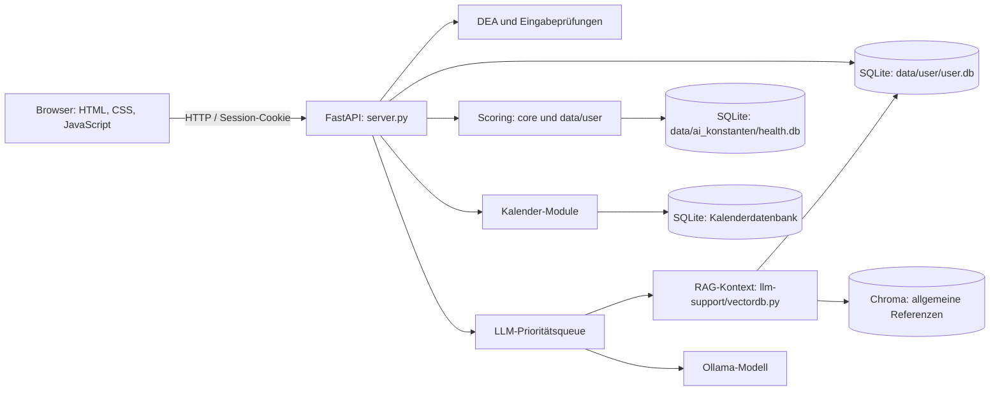

# Rebuild: Architektur nach Funktionsbereichen

Diese Seiten beschreiben, wie die großen Features im aktuellen Quellcode zusammenspielen. Sie dokumentieren den Ist-Zustand, einschließlich wichtiger Offline-Fallbacks und Grenzen.

## Architekturüberblick

Der Browser rendert die Seiten und steuert Formulare, Diagramme und lokale Erinnerungs-Timer. `server.py` liefert Seiten aus und stellt FastAPI-Endpunkte bereit. Nutzerbezogene Daten laufen über `data/user/db_interaction.py`; Referenzkataloge, Modellgewichte und Impact-Werte liegen getrennt davon. Der KI-Assistent kombiniert ausgewählte Nutzerdaten mit allgemeinen Chroma-Referenzen und sendet den Kontext über die Queue an Ollama.

## Feature-Dokumente

- [Konto, Anmeldung und DEA](account-and-login.md)
- [Übersicht und Scores](dashboard-and-scores.md)
- [Check-ins](check-ins.md)
- [Schlaf und Brain](sleep-and-brain.md)
- [Ernährung und Stomach](nutrition-and-stomach.md)
- [Aktivität](activity.md)
- [Empfehlungen](recommendations.md)
- [KI-Assistent, RAG und Queue](opty-llm.md)
- [Kalender](calendar.md)
- [Browser-Erinnerungen](browser-reminders.md)

## Datenhaltung im Überblick

| Speicher | Zweck | Zugriff |
|---|---|---|
| `data/user/user.db` | Konten, Profile, Check-ins, Scores und persönliche LLM-Zusammenfassungen | `data/user/db_interaction.py` |
| `data/ai_konstanten/health.db` | Essens-/Aktivitätskataloge, Merkmalsvektoren, Score-Impacts und Schlafreferenzen | `core/input_vector.py` |
| Kalenderdatenbank | Kalenderaufgaben und Google-iCal-Verknüpfungen | `Kalender/data/database.py` |
| `chroma_data/` | persistente allgemeine Referenzdokumente für RAG | `llm-support/vectordb.py` |
| Modellgewichte | lokale Bewertungsnetze für Essen und Aktivität | `core/ai/ai.py` |

Die Queue-Prioritäten, der DEA-Umfang und die Berechnungswege sind in den jeweiligen Feature-Seiten genauer beschrieben. Diese Dokumentation ist keine API-Spezifikation; Änderungen an Endpunkten oder Tabellen müssen im Code geprüft werden.
