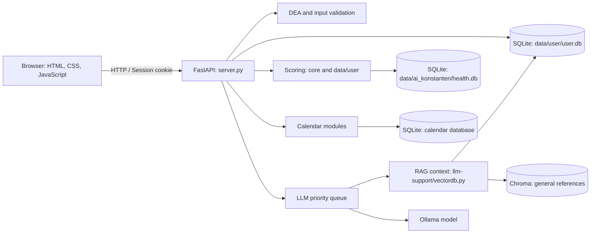

# Rebuild: Feature Architecture

These pages describe how the major features work together in the current source code. They document the current implementation, including important offline fallbacks and limitations.

## Architecture overview

The browser renders pages and manages forms, charts, and local reminder timers. `server.py` serves pages and FastAPI endpoints. User data goes through `data/user/db_interaction.py`; reference catalogs, model weights, and impact values are stored separately. The AI assistant combines selected user data with general Chroma references and sends the context to Ollama through the queue.

## Feature guides

- [Account, sign-in, and input validation](account-and-login.md)
- [Overview and scores](dashboard-and-scores.md)
- [Check-ins](check-ins.md)
- [Sleep and Brain](sleep-and-brain.md)
- [Nutrition and Stomach](nutrition-and-stomach.md)
- [Activity](activity.md)
- [Recommendations](recommendations.md)
- [Opty, RAG, and the queue](opty-llm.md)
- [Calendar](calendar.md)
- [Browser reminders](browser-reminders.md)

## Data storage overview

| Store | Purpose | Access |
|---|---|---|
| `data/user/user.db` | Accounts, profiles, check-ins, scores, and personal LLM summaries | `data/user/db_interaction.py` |
| `data/ai_konstanten/health.db` | Food/activity catalogs, feature vectors, score impacts, and sleep references | `core/input_vector.py` |
| Calendar database | Calendar tasks and Google iCal connections | `Kalender/data/database.py` |
| `chroma_data/` | Persistent general reference documents for RAG | `llm-support/vectordb.py` |
| Model weights | Local scoring networks for food and activity | `core/ai/ai.py` |

Queue priorities, the scope of input validation, and calculation paths are described in the feature guides. This documentation is not an API specification; check the code for changes to endpoints or tables.
